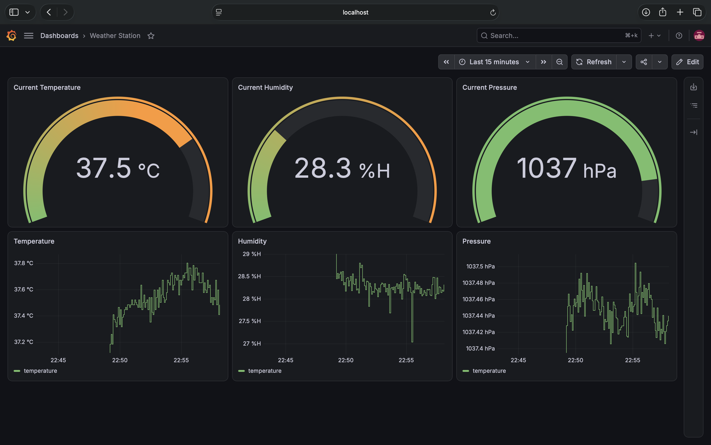
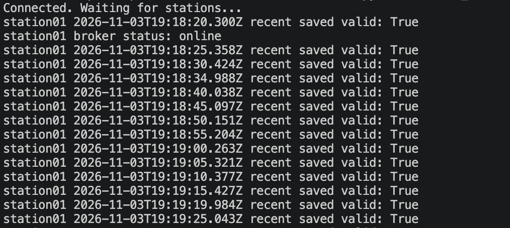
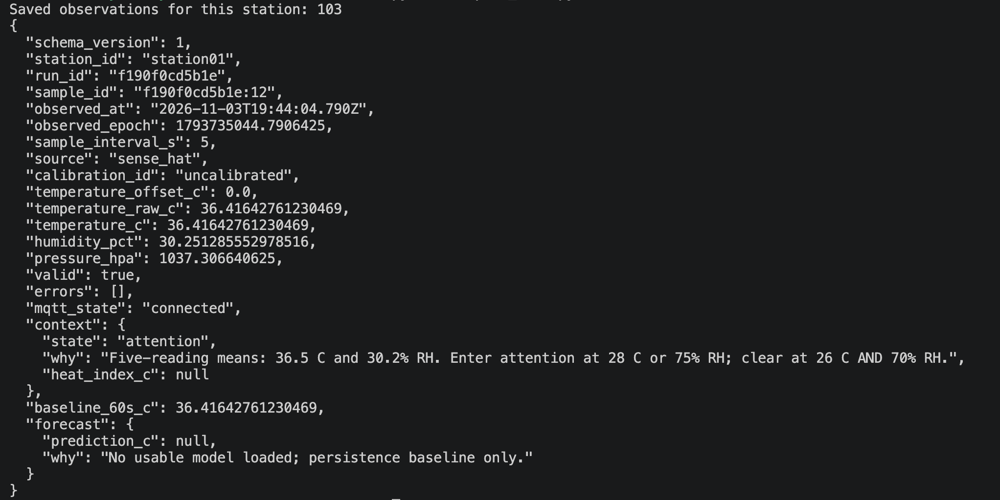
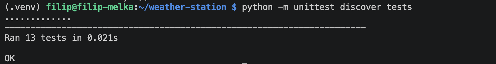
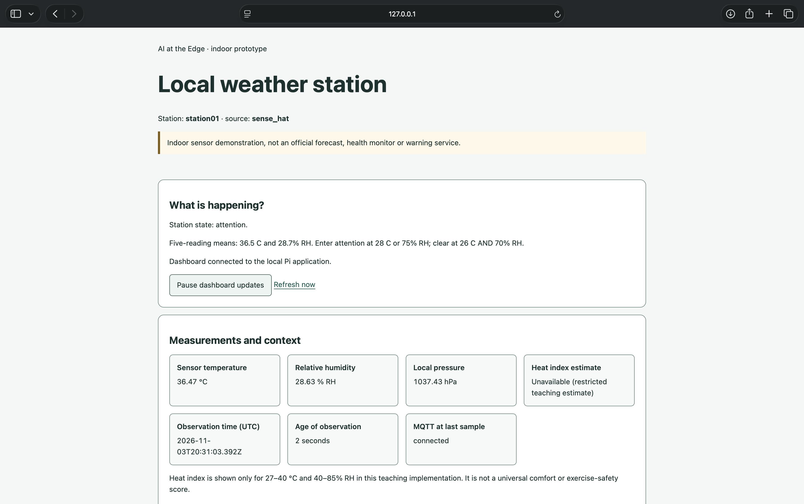
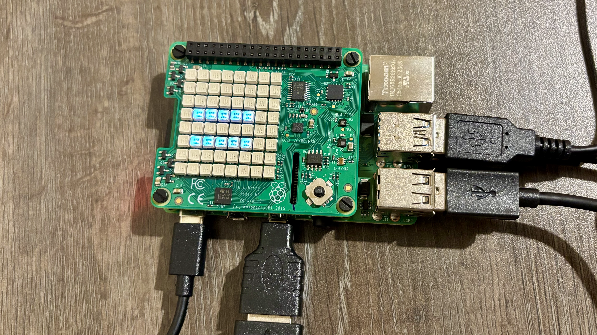

# Weather Station

**Name:** Filip Melka
**Student ID:** C00288344

## Learning Outcomes

- Setting up and safely handling a Raspberry Pi and Sense HAT
- Reading sensors and validating readings (missing data is never zero)
- Storing data locally in SQLite with a retention policy
- Sending data between devices with MQTT and a Mosquitto broker
- Designing for network failure and recovering missed data
- Turning raw readings into explained states with hysteresis
- Training a model on a PC and running it on the Pi in shadow mode
- Measuring speed and memory on edge hardware
- Building a clear, accessible LED and web interface
- Testing code with unit tests
- Assessing privacy, security, fairness and retention risks

## Beyond the Workbook

I added a Grafana dashboard on my laptop, reading `data/central.db` through the SQLite data source, to show live gauges and history charts of the readings.



## Week 1 (Get comfortable with your Raspberry Pi)

- Covered safe handling: power off before touching the HAT, correct 5.1 V / 3 A supply, never pull the microSD card or power while running.
- Imaged the card, assembled the Pi and Sense HAT, connected to eduroam and updated the OS.
- Set up the project folders and a Python virtual environment.
- Wrote and tested `hello_pi.py`, then practised backups and a safe shutdown.

### Pause and Predict notes

- **Program stopped printing, safe to remove the card?** No, background tasks may still be writing. Shut down and cut power first.
- **Verifying vs backing up?** Verifying checks the image was written correctly. A backup is a separate copy of my work.
- **Second copy on the same card?** Both are lost if the card fails. Back up to separate storage.

## Week 2 (Measure with the Sense HAT)

- Read temperature, humidity and pressure (`read_sensors.py`), with settings in `config.json` and a separate `config_sim.json` for simulated data.
- `common.py` defines a reading (units, UTC time, bounds checks); invalid values become `null` with a reason, never zero.
- `sensors.py`, `storage.py` and `station.py` collect readings into a local SQLite database; `inspect_data.py` reads them back.
- `tests/test_core.py` checks invalid values, timestamps, duplicates and retention.

## Week 3 (Send observations to a PC)

- The Pi publishes readings over MQTT (`mqtt_link.py`, Mosquitto broker); the PC receives, validates and archives them (`central_receiver.py`).



- `station.py` always saves locally first, so collection continues if the network is down.
- The broker is anonymous and unencrypted, so it is a demo only.
- `replay_history.py` (stretch) resends saved readings to fill gaps.

## Week 4 (Make the readings meaningful)

- `features.py` turns the last five valid readings into six features; the window resets after invalid data or a gap.
- `context.py` gives each reading a state (`warming_up`, `normal`, `attention`, `unknown`) with a reason, using hysteresis so it doesn't flicker.
- Added a heat-index estimate that returns `None` outside its valid range.



- `tests/test_context.py` covers windows, gaps, hysteresis and limits.



## Week 5 (Deploy and evaluate a small model)

- `train_model.py` (PC) trains a Ridge model to forecast the sensor temperature 60 seconds ahead, using chronological splits and a "no change" baseline.
- `model_runtime.py` runs the exported JSON model on the Pi and abstains when inputs don't match or are out of range.
- `generate_demo_data.py` makes labelled simulated data; `timing.py` and `benchmark.py` measure speed on the Pi.
- The model runs in shadow mode and never controls the alert.

```json
{
  "platform": "Linux-6.18.50+rpt-rpi-v8-aarch64-with-glibc2.41",
  "python": "3.13.5",
  "model_id": "e3e62634dddf",
  "model_bytes": 1492,
  "model_load_ms_one_run": 0.431901,
  "persistence": {
    "n": 5000,
    "median_ms": 0.0005,
    "p95_ms": 0.000611,
    "cpu_seconds": 0.005233185000000001,
    "wall_seconds": 0.005231496000305924,
    "one_core_cpu_percent": 100.03228521428629
  },
  "ridge_arithmetic_only": {
    "n": 5000,
    "median_ms": 0.006074,
    "p95_ms": 0.006278,
    "cpu_seconds": 0.033915851,
    "wall_seconds": 0.03391103400008433,
    "one_core_cpu_percent": 100.01420481580023
  },
  "process_peak_rss_mib": 13.796875,
  "last_station_run": "80640639e62a",
  "last_station_source": "sense_hat",
  "local_sample_path": {
    "n": 20,
    "median_ms": 45.460388,
    "p95_ms": 61.150778
  },
  "scope": "Model timing excludes sensor IO and training. Local sample path includes sensor read, features/inference, LED update where enabled, SQLite commit and MQTT enqueue where enabled. It excludes sample waiting, broker delivery, browser refresh and runtime CSV logging. CPU time is NOT energy; measure watts with suitable hardware."
}
```

> Measured on the Pi (Python 3.13.5): ridge prediction median 6 µs (p95 6.3 µs); full local sample path median 45 ms (p95 61 ms, n = 20); process peak memory 13.8 MiB; model file 1.5 KB. Model trained on simulated data, so it abstains on real readings; timings measure the arithmetic only.

## Week 6 (Build a calm, understandable interface)

- `matrix.py` shows one symbol on the LED matrix (`O`, `!`, `?`, `=`); only `station.py` controls the HAT.
- `webapp.py` is a local Flask dashboard (loopback only) that shows stale or invalid readings as "Unavailable" with a reason.
- Two separate pauses: visual alerts for 60 seconds, and dashboard updates in the browser. Neither stops sensing.
- Symbols as well as colour, keyboard focus and a no-JavaScript fallback; `tests/test_web.py` covers the web checks.





## Week 7 (Decide what responsible use would require)

- Mapped the data lifecycle and linked each risk to evidence in the code (privacy, security, transparency, reliability, accessibility).
- `clear_retained.py` clears this station's retained broker messages; the PC archive and local database need separate deletion.

## Documents

- [`data-flow.md`](docs/data-flow.md): where the data goes and who can access it
- [`lesi-review.md`](docs/lesi-review.md): legal, ethical and societal risk review
- [`retention.md`](docs/retention.md): what is kept, for how long, and how to delete it
- [`privacy-notice.md`](docs/privacy-notice.md): a plain-language notice for users
- [`final-review.md`](docs/final-review.md): what was built, tested and still missing